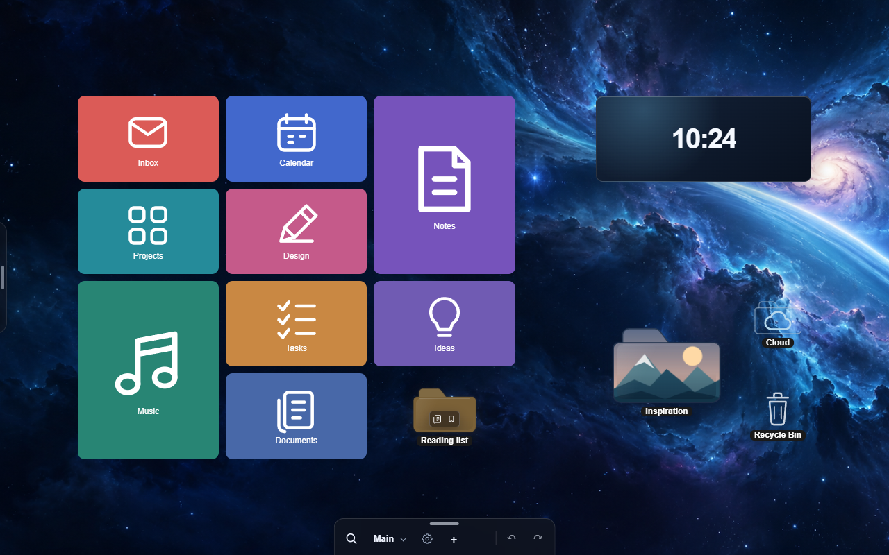
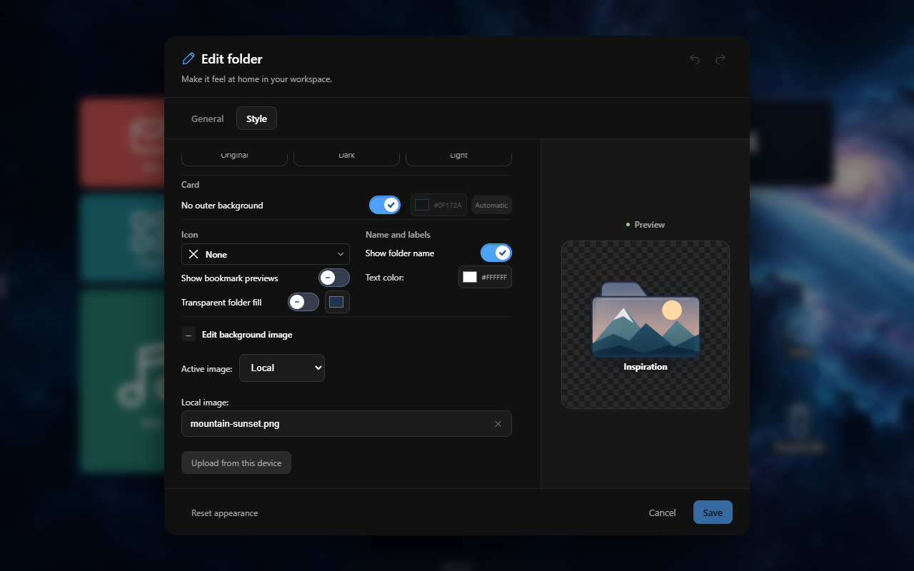
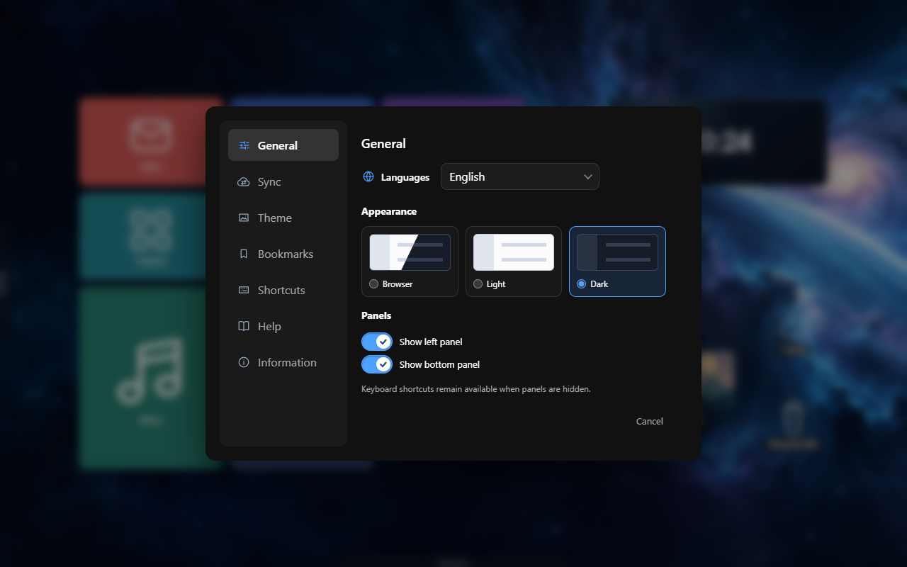
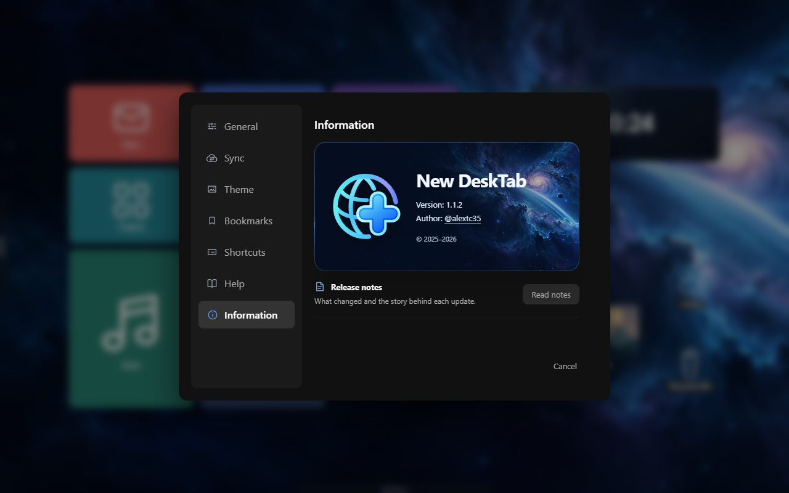

<p align="center">
  
</p>

<h1 align="center">New DeskTab</h1>

<p align="center">
  <strong>Your new tab. Your own space.</strong><br>
  Turn your favorite websites into a desktop you can arrange, personalize and make your own.
</p>

<p align="center">
  Chrome &nbsp;·&nbsp; 52 languages &nbsp;·&nbsp; No account required
</p>

<p align="center">
  <a href="#get-started">Get started</a> &nbsp;·&nbsp;
  <a href="#make-it-yours">Take a look</a> &nbsp;·&nbsp;
  <a href="docs/guide/USER_GUIDE.md">User guide</a> &nbsp;·&nbsp;
  <a href="https://github.com/Alextc35/newdesktab/issues">Feedback &amp; support</a>
</p>

[](assets/store/screenshot-1280x800.png)

<p align="center"><sub>An example workspace. Each bookmark card opens a website you choose.</sub></p>

## A home for the things you open every day

New DeskTab replaces your browser's new tab with a visual bookmark workspace.
Keep your everyday links close, group the rest into folders, and create separate
spaces for work, study or whatever you are into.

| Arrange your way | Keep things together | Set the mood |
| :--- | :--- | :--- |
| Move and resize bookmark cards on a flexible grid. Give important links more room. | Organize links into folders and switch between independent workspaces. | Choose colors, category icons, cover images and image or video wallpapers. |

## Make it yours

Start with a few links, then shape the space around the way you use the web.
Save favorite styles as presets and reuse them across your bookmarks.

<table>
  <tr>
    <td width="50%" valign="top">
      <a href="assets/store/screenshot-folder-1280x800.png"></a>
      <p><strong>Give every folder its own look</strong><br>Choose a cover, colors and icon, with a preview as you edit.</p>
    </td>
    <td width="50%" valign="top">
      <a href="assets/store/screenshot-settings-1280x800.png"></a>
      <p><strong>Make yourself comfortable</strong><br>Use a light or dark interface, choose your language and show the panels you need.</p>
    </td>
  </tr>
</table>

## Small details that help every day

- **Save the page you are on.** Click the extension icon to add it to a workspace
  or folder. Existing favorites are identified in the popup.
- **Edit with room to change your mind.** Select several bookmarks, move or style
  them together, and undo or redo workspace changes.
- **Keep your bookmarks in sync.** Enable optional Chrome Sync to share bookmarks
  and settings across your Google Chrome devices.
- **Keep a copy.** Export your New DeskTab bookmarks or make a complete backup,
  including the local media referenced by your workspace.
- **Learn as you go.** A welcome guide, searchable manual and optional daily tips
  are built in, with 52 bundled interface languages.
- **Add a clock.** A resizable clock widget is included and is still in development.
  More work on widgets is planned for upcoming updates.

<details>
  <summary><strong>A closer look at New DeskTab</strong></summary>

  <p>The Information panel brings together the installed version, author and release history.</p>
  
</details>

## Get started

Requires **Chrome / Chromium 123 or newer**, or a compatible Brave version.
To install only the extension files, generate a clean package first.
Packaging requires **Node.js/npm and Python 3.9 or newer**. If you already have
a generated extension ZIP, start at step 3.

1. Download the repository with **Code → Download ZIP** and extract it, or clone it:

   ```sh
   git clone https://github.com/Alextc35/newdesktab.git
   ```

2. Open a terminal in the repository folder and generate the extension ZIP:

   ```sh
   npm run package:store
   ```

   If your system uses `python` instead of `python3`, run
   `python scripts/package-extension.py` instead. Installing development
   dependencies with `npm ci` is not required for packaging.

3. Extract the generated `dist/newdesktab-<version>.zip` into a folder you will
   keep on your computer.
4. Open `chrome://extensions` in Chrome or `brave://extensions` in Brave.
5. Turn on **Developer mode**, choose **Load unpacked**, and select the
   **extracted folder containing `manifest.json`**.
6. Open a new tab. Follow the welcome guide, or press **B** to add your first bookmark.

**A few useful defaults:** `E` to edit · `B` to add a bookmark · `S` for settings ·
`/` to search · `Ctrl + ↑ / ↓` to switch workspaces.
The [user guide](docs/guide/USER_GUIDE.md) covers customization, shortcuts and backups.

## Your data, your choice

New DeskTab starts in **Local mode**, saving your workspace in your browser profile.
It has no New DeskTab account, developer-operated backend or analytics.

Optional **Chrome Sync** can share bookmark data and settings through your Google
Chrome profile. Brave uses Local mode. Uploaded images and videos stay on the
device; complete backups can carry referenced local media to another profile.

Website icons are requested from Google's favicon service, and remote images or
videos load from their hosts. Read the [privacy policy](PRIVACY.md) for the full
details on storage, network requests and exports.

## Explore the project

| I want to… | Start here |
| :--- | :--- |
| Learn the controls and organize my space | [User guide](docs/guide/USER_GUIDE.md) |
| Find technical documentation | [Documentation index](docs/README.md) |
| Run checks or work on the extension | [Development guide](docs/development/DEVELOPMENT.md) · [Contributing](CONTRIBUTING.md) |
| See what changed | [Changelog](CHANGELOG.md) |
| Report a problem or suggest an idea | [GitHub issues](https://github.com/Alextc35/newdesktab/issues) |

<p align="center">
  Made by <a href="https://github.com/Alextc35">Alextc35</a> &nbsp;·&nbsp;
  Open source under the <a href="LICENSE">MIT License</a>
</p>
